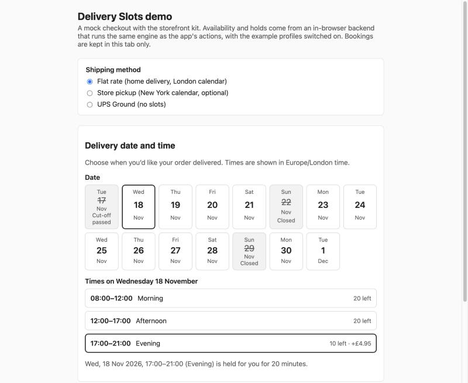
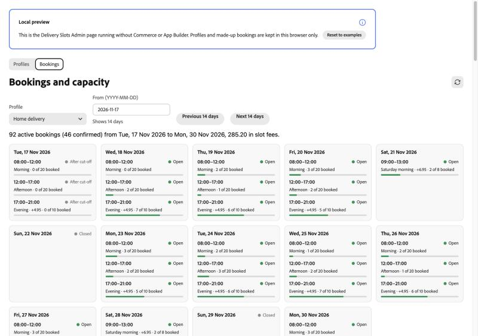
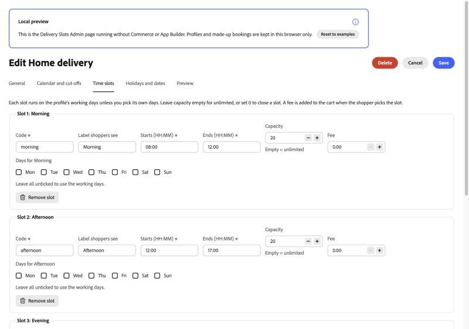

# Delivery Date & Time Slots for Adobe Commerce

[](https://github.com/sohelrana09/commerce-delivery-slots/actions/workflows/ci.yml)
[](https://developer.adobe.com/app-builder/)
[](https://business.adobe.com/products/commerce.html)
[](https://nodejs.org/)
[](storefront/README.md)
[](https://react-spectrum.adobe.com/)
[](https://github.com/sohelrana09/commerce-delivery-slots)
[](LICENSE)

**Delivery and pickup date and time slots at checkout for Adobe Commerce, with capacity, cut-offs and fees, built as an App Builder app.**

Built by [Sohel Rana](https://sohelrana.io), Adobe Certified Master Architect and Claude Certified Architect – Foundations (CCAR-F).

[Quick start](#quick-start) · [Screenshots](#screenshots) · [Profile format](docs/profiles.md) · [Webhooks and events](docs/webhooks.md) · [Storefront kit](storefront/README.md) · [Contributing](CONTRIBUTING.md)

Delivery Slots lets shoppers choose **when** their order arrives, or when they collect it: a date, then a time slot such as **"Wed 18 Nov, 17:00–21:00 (Evening)"**. Each slot has a capacity, so a van or a pickup counter is never overbooked. Merchants manage the calendars in the Commerce Admin, with no code and no deployment.

It replaces the delivery date modules merchants used to buy for Magento, and it runs **out of process**. So it works on **Adobe Commerce as a Cloud Service (SaaS)**, where PHP modules can't be installed, as well as on Adobe Commerce on cloud infrastructure and on-premises (PaaS).

**Key features**

- **Calendars that know the rules:** working days, holidays (once or every year), blackout periods, a lead time, and how many days ahead shoppers can book.
- **Cut-offs:** a same-day cut-off ("order by 10:00 for today") and a next-day cut-off ("order by 18:00 for tomorrow"), in the store's own time zone, correct across daylight saving changes.
- **Slots with capacity and fees:** any number of slots per day, each with its own days, capacity and optional fee (added to the cart as a custom fee). Override one date: close it, open a Sunday, or change a slot's capacity.
- **One calendar per method and store view:** profiles match shipping methods (`flatrate_flatrate`, `flatrate_*` or a carrier) and store views, with a priority when several match. Delivery and pickup wording.
- **Never overbooked:** the slot is held while the shopper pays and booked atomically when the order is placed. Capacity is released when an order is cancelled, a hold expires, or an admin releases it.
- **On the order:** the chosen date and slot are saved on the order as custom attributes and as an order comment, both visible in the Admin.
- **Accessible checkout:** native radio groups that work with the keyboard and screen readers, a live region for status, and clear reasons for every unavailable date.



---

## Contents

- [Who it is for](#who-it-is-for)
- [What shoppers see](#what-shoppers-see)
- [What you manage as a merchant](#what-you-manage-as-a-merchant)
- [Screenshots](#screenshots)
- [How it works](#how-it-works)
- [Quick start](#quick-start)
- [Configuration](#configuration)
- [Commands](#commands)
- [Project structure](#project-structure)
- [What needs a live instance](#what-needs-a-live-instance)
- [Roadmap](#roadmap)
- [FAQ](#faq)
- [Contributing](#contributing)

## Who it is for

- **Merchants** with their own delivery fleet, click and collect, or bulky goods, moving to Adobe Commerce as a Cloud Service and needing the delivery date module they had on Magento.
- **Grocery, food, furniture and florist stores**, where the delivery slot is part of what the shopper buys and capacity is real.
- **Agencies and developers** who need a reference build: checkout webhooks, Commerce events, an Admin UI SDK page, App Management settings and App Builder Database Storage with atomic counters, in one small, tested app.

## What shoppers see

| Feature | What it means in practice |
|---|---|
| **A date, then a time** | The next 14 open dates (more on request), then that date's slots with their times, label, fee and, if you choose, places left. |
| **Clear reasons** | Closed, holiday, cut-off passed, full or too soon: unavailable dates and slots stay in the list, disabled, with the reason as text. |
| **Their own time zone explained** | Times are the store's local times, and the picker says so when the shopper's browser is in a different zone. |
| **Held while they pay** | Picking a slot holds a place for 20 minutes (you choose), so it can't fill up during payment. |
| **No surprises at the end** | If the slot has gone by the time they place the order, checkout stops with a clear message and the picker shows the current times. |
| **Keyboard and screen reader friendly** | Tab into a group, arrow keys to move, Space to choose. Status messages are announced. |

## What you manage as a merchant

Everything is in the Commerce Admin. There is nothing to deploy for a new calendar or a holiday.

| You want to... | Where |
|---|---|
| Set up home delivery or click and collect | **Delivery Slots → Profiles** in the Admin menu. Start from an example or from scratch. |
| Set working days, cut-offs, lead time and how far ahead | The profile's **Calendar and cut-offs** tab. |
| Add slots with capacity and fees | The profile's **Time slots** tab. |
| Close for a holiday, a shutdown or one day; open a Sunday | The profile's **Holidays and dates** tab. |
| See what shoppers will be offered | The profile's **Preview** tab, at any date and time you pick. |
| See how full each slot is, and who booked it | **Delivery Slots → Bookings**: capacity per slot for 14 days, and every booking with its order or cart. |
| Free a place by hand | **Release** on a booking. |
| Switch slots off, change the hold time or the feed's cache | **Apps → App Management → Delivery Slots → Configure**. |
| Keep profiles in version control | `SLOT_PROFILES` in `.env` (see [Configuration](#configuration)). |

## Screenshots

| Bookings and capacity | Editing time slots |
|---|---|
|  |  |

Both come from the local Admin preview (`npm run admin:preview`) with made-up bookings. The checkout picker above comes from the local demo (`npm run demo`).

## How it works

```
Commerce Admin ──> Delivery Slots page (Admin UI SDK, React Spectrum 2)
                     │  IMS sign-in
                     v
               App Builder (I/O Runtime) <──> App Builder Database Storage
                     ^      ^      ^           slot_profiles, slot_usage, slot_reservations
                     │      │      │
 availability, hold  │      │      └── order saved event: confirm, or release on cancel
 (public)            │      └── place-order webhook: validate and book the slot
                     │
Browser ──> EDS checkout drop-in + storefront kit ──> setCustomAttributesOnCart
```

1. The checkout kit asks the **availability** feed for the cart's shipping method and draws the dates and slots.
2. When the shopper picks a slot, the kit calls **hold** with the masked cart ID. The slot is checked and a place is held for the cart.
3. Before placing the order, the kit saves the date and slot on the cart as **custom attributes** (`delivery_date`, `delivery_slot`, `delivery_profile`). Commerce copies them to the order.
4. The **place-order webhook** checks the slot again and books it, or stops the order with a message the shopper sees.
5. The **order saved event** confirms the booking and adds an order comment; a cancelled order releases the place.

Key design choices:

- **One engine.** [`delivery-slots-engine.js`](storefront/scripts/delivery-slots-engine.js) has no dependencies and is shared by the checkout kit, the Admin preview and the actions, so what a merchant previews is what shoppers are offered and what the webhook accepts.
- **Time zones done properly.** Every rule runs in the profile's IANA time zone, and every slot also gets exact UTC instants, so cut-offs and lead times stay right on daylight saving days.
- **Atomic capacity.** Each slot has one counter, incremented only while it is below capacity, in a single database operation. Two shoppers can't both get the last place.
- **Idempotent.** Every reservation change is filtered on its current state, so a retried webhook or a redelivered event never counts or releases a place twice.
- **Fail open, by choice.** If the slot can't be checked when an order is placed (a database outage, say), the order goes through by default, and the place the shopper held at checkout is confirmed when the order event arrives. Merchants who'd rather stop the order can switch that off.

More in [docs/architecture.md](docs/architecture.md).

## Quick start

**You need:** Node.js 24 (`.nvmrc` pins it), the Adobe I/O CLI (`npm install -g @adobe/aio-cli`), an App Builder project in the same Adobe organization as your Commerce instance, and an Edge Delivery Services storefront with the Commerce checkout drop-in.

1. **Clone and install**

   ```bash
   git clone https://github.com/sohelrana09/commerce-delivery-slots.git
   cd commerce-delivery-slots
   npm install
   npm test
   ```

2. **Try it locally (optional)**

   ```bash
   npm run demo
   ```

   Open http://localhost:4371. It is a mock checkout with the real storefront kit and an in-browser backend that runs the same engine, with the example profiles switched on. Switch shipping methods, pick slots, and use **Fill the next slot** to see a slot fill up.

   To see the Admin page without Commerce or an Adobe account:

   ```bash
   npm run admin:preview
   ```

   Open http://localhost:4370/preview.html. It is the real Admin page (profiles, editor with preview, and bookings), with profiles and made-up bookings kept in your browser's local storage. **Reset to examples** starts over.

3. **Deploy**

   In the [Adobe Developer Console](https://developer.adobe.com/console), add **I/O Management API**, **Adobe I/O Events for Adobe Commerce**, **App Builder Data Services** and an **OAuth Server-to-Server** credential to the workspace. Then:

   ```bash
   aio login
   aio app use --merge
   cp env.dist .env
   aio app deploy
   ```

   Note the URLs it prints for `delivery-slots/availability` and `delivery-slots/hold`: the checkout kit calls them.

4. **Install in Commerce**

   In the Commerce Admin, open **Apps → App Management** and install **Delivery Slots**. It registers the place-order and custom-fee webhooks and the order event, sets up the database, and adds **Delivery Slots** to the Admin menu. Give its ACL resource to the admin roles that manage slots, then open **Delivery Slots**, start from an example and switch it on.

5. **Add the checkout kit**

   Copy the files in [`storefront/`](storefront/README.md) into your storefront, mount the picker in `blocks/commerce-checkout/commerce-checkout.js`, and add two lines to the place-order handler. The [storefront guide](storefront/README.md) has the code.

The full guide, with settings, data and troubleshooting, is [docs/installation.md](docs/installation.md).

## Configuration

**App Management** (Apps → App Management → Delivery Slots → Configure):

| Setting | Purpose |
|---|---|
| Offer delivery date and time slots at checkout | The master switch (on by default). Off: the feed returns no profile, and orders are accepted without a slot. |
| Minutes a chosen slot is held | How long a picked slot is held for the cart, 5 to 240 (default 20). |
| Seconds browsers and the CDN may cache slot availability | 0 to 3600 (default 30). Keep it short: places left change as orders come in. |
| Show shoppers how many places are left | Show "3 left" on each slot (off by default). |
| Allow orders when the slot check fails unexpectedly | Fail open when the database is unreachable (on by default). A full slot still blocks the order. |
| Add the chosen slot to the order as an internal comment | Written when the order is confirmed (on by default). |

**Environment** (`.env`, never commit it; `env.dist` lists every variable):

| Variable | Purpose |
|---|---|
| `LOG_LEVEL` | `debug`, `info` (default), `warn` or `error`. |
| `SLOT_PROFILES` | Optional. A JSON array of profiles; when set, they're used instead of the Admin page's profiles. |
| `WEBHOOK_PUBLIC_KEY` | Optional. The Commerce webhook public key (PEM), to verify webhook signatures as well as the IMS token. |

**Checkout kit** (`mountDeliverySlots(container, {...})`): `availabilityEndpoint`, `holdEndpoint`, `storeView`, `currency`, `events`, `graphql` and more, see the [storefront guide](storefront/README.md#options).

## Commands

| Command | What it does |
|---|---|
| `npm test` | Unit tests with coverage (Vitest). No Adobe account needed: the database, Commerce and I/O Runtime are faked. |
| `npm run code:check` / `npm run code:fix` | Biome lint and format. |
| `npm run typecheck` | TypeScript check of the Admin page. |
| `npm run demo` | The checkout kit in a mock checkout, at http://localhost:4371. |
| `npm run admin:preview` | The Admin page with an in-browser store, at http://localhost:4370/preview.html. `PORT` changes the port. |
| `aio app dev` | The Admin page locally, against the workspace's actions. |
| `aio app build` / `aio app deploy` | Build, or build and deploy to the selected workspace. |

## Project structure

```
app.commerce.config.ts       App Management: Admin menu, settings, webhooks, event, install step
storefront/                  the checkout kit (copied into an EDS storefront)
    scripts/delivery-slots-engine.js   the calendar engine, shared by everything (imported as #engine)
    scripts/delivery-slots.js          the accessible date and slot picker
    styles/delivery-slots.css          picker styles
src/common/slots/            database, capacity counters, reservations, profiles, settings, payload readers
src/commerce-extensibility-1/
    actions/availability/    public: dates and slots for a shipping method
    actions/hold/            public: hold or release a slot for a cart
    actions/validate-order/  place-order webhook: check and book the slot
    actions/slot-fee/        totals webhook: the slot's fee as a custom fee
    actions/order-events/    order saved event: confirm, or release on cancel
    actions/cleanup/         every 10 minutes: expire old holds
src/commerce-backend-ui-2/
    actions/                 Admin actions: profiles, bookings, release, lookups
    web-src/                 the Admin page (React Spectrum 2)
scripts/setup-database.js    the App Management install step
scripts/admin-preview.js     local Admin page preview (Parcel)
demo/                        local mock checkout
docs/                        guides and screenshots
test/                        unit tests
```

## What needs a live instance

There was no Adobe Commerce instance to test on while this was built, so everything is unit tested and checked in the local previews, and these points still need confirming on a real instance:

- that the cart's custom attributes reach the **place-order webhook** payload, and at which path (the app reads several known shapes);
- that `observer.sales_order_save_commit_after` carries the order's `state`, so cancellations release the place;
- that the **slot fee** (`result/fees` replace) sits well next to other apps that add custom fees;
- App Builder Database Storage's handling of the conditional increment and unique indexes under real load.

[docs/webhooks.md](docs/webhooks.md) lists each one with what to check and how to change it.

## Roadmap

Done: calendar engine with working days, holidays, blackouts, overrides, lead time, same-day and next-day cut-offs, time zones and DST; profiles per shipping method and store view; capacity with atomic counters; holds, place-order validation and booking, cancellation release, expiry sweep; slot fees as custom fees; order comment; Admin page with profiles, preview and bookings; App Management settings; profiles in code; accessible checkout kit; local demo and Admin preview; unit tests.

Next:
- Install and check on a live Adobe Commerce as a Cloud Service instance, then submit to the Adobe Commerce Marketplace.
- The slot in order emails and on the customer's order page.
- Capacity shared between profiles (one van for two methods), and capacity by order weight or item count.
- Per-postcode zones.
- A CSV export of bookings for drivers.

Ideas and pull requests are welcome, see [Contributing](#contributing).

## FAQ

**Is this an official Adobe product?**
No. Delivery Slots is an independent open-source project. Adobe, Adobe Commerce and App Builder are trademarks of Adobe.

**What happens if the app is down when an order is placed?**
If the app's own check fails (a database outage, say), the order goes through by default, and the place the shopper held at checkout is confirmed when the order event arrives, even if the slot has filled up since, because the order exists. If App Builder can't be reached at all, Commerce stops the order with a "try again" message, because the webhook is registered as required; [docs/webhooks.md](docs/webhooks.md#failure-policy) explains how to change that. Switch **Allow orders when the slot check fails unexpectedly** off to stop the order in the first case too.

**Can two shoppers get the last place?**
No. A place is taken by one database operation that only succeeds while the slot is below capacity.

**Do abandoned carts block slots?**
Only for the hold time (20 minutes by default). Holds expire by themselves, and a sweep every 10 minutes gives the places back.

**Can a script drain capacity through the public hold action?**
Each hold needs a real, active cart's masked ID, and one cart holds at most one place. A script would need to create real carts, which Commerce rate-limits.

**Does it work without Edge Delivery Services?**
The engine has no dependencies, and the actions are plain HTTP. Any storefront (headless, Next.js, PWA) can call the availability and hold actions and set the same cart custom attributes.

**Does it work on PaaS?**
Yes, with Adobe Commerce 2.4.7+ and the out-of-process extensibility modules (webhooks, eventing, and `magento/out-of-process-custom-attributes` for cart custom attributes).

**Is it production-ready?**
It is tested (unit tests, the Admin page and the checkout kit in local previews), but it hasn't been installed on a live Commerce instance yet. Before going live, work through [What needs a live instance](#what-needs-a-live-instance) on a Stage workspace and instance.

## Contributing

Bug fixes, calendar rules, storefront improvements and better documentation are all welcome. For larger changes, open an issue first so we can agree on the approach.

1. Fork the repository and create a branch: `git checkout -b feature/your-change`.
2. Make your change, following the [project structure](#project-structure): calendar logic goes in the engine with unit tests, server-only code in `src/common/slots`, and actions stay thin.
3. Run the checks: `npm run code:check`, `npm run typecheck` and `npm test`, plus `npm run demo` for anything a shopper sees and `npm run admin:preview` for anything on the Admin page.
4. Commit, push the branch and open a pull request that says what changed and how you tested it.

The full guide is in [CONTRIBUTING.md](CONTRIBUTING.md). Please report security problems privately, see [SECURITY.md](SECURITY.md), and follow the [code of conduct](CODE_OF_CONDUCT.md).

## License

[MIT](LICENSE). You may use, change and redistribute Delivery Slots, also in commercial projects, as long as the copyright notice stays.

---

Made with Adobe App Builder and Edge Delivery Services. If Delivery Slots helps you, please give it a star.
